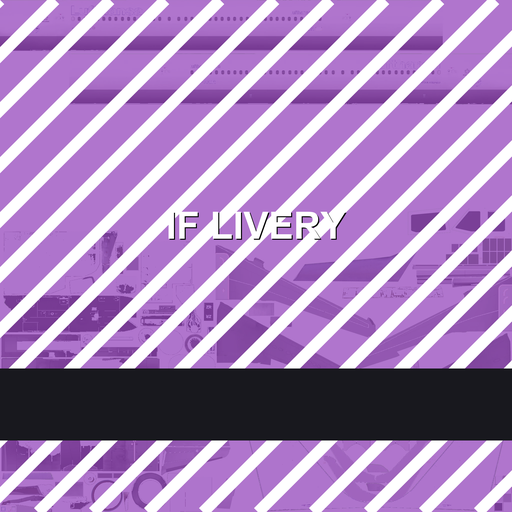

# Infinite Flight リバリーパイプライン

**root なし、脱獄なし、APK 改造なしで、Infinite Flight の機体を塗り替える。**

[English](README.md) · 日本語 · [繁體中文](README.zh-Hant.md)



---

## まえがき —— もう愛想よくするのはやめる

こちらの金で買っている。だから「いつ出るのか」と聞く権利はないらしい。遅延は遅延ではなく
「soon™」で、それを指摘すると空気を読まない奴になる。結構。その商売、盛大に拍手でも送っておこう。

そして擁護部隊である。フォーラムも SNS も配信プラットフォームも、全部動員されている。誰かが
金をもらって「全部うまくいってます」と説明している。広報費がいくらなのか本気で知りたい。
大陸の華為（ファーウェイ）と同じ桁なのは間違いない。草。

IFATC の採用基準はサイクルごとに下がる一方。Officer のレーダー講習には誰も来ない。昇進はコネで
決まる。ローラは収益化で忙しい。VA は消耗品で、Live が本命。IFAET の採用と研修はもはや謎 —
入ったら誰も研修しない。前世紀の研修マニュアルを渡されて、前世紀のエディタを指差される。
ほら、操作しろよ。

ついでに言えば、空港のイースターエッグは使用禁止、家の斜め屋根は禁止。ああ、この鉄の箱感が
たまらない。正方形の空港、もっと増やしてください、最高です。そう、エディタは新しくなった。
あの UI を見れば、このチームに AI 支援コーディングがどれだけ入っているか一目で分かる。
AI 最高。一部のパネルは、最適化した後でも不自然すぎて、部外者が部屋に立っているような
異物感がある。

一方で、コミュニティでスパイごっこをして他人を蹴落とし、傲慢に振る舞う連中は何の問題もない。
金が回っていれば、それでいい。何も見なかったことにしよう。

塗装？ お前らが要求する立場だと思っているのか。こちらは好きにする。**納品側が上**なのだ。

投票？ あれは大陸の人大代表と同じ喜劇だ。民主主義の見た目をして、機能は飾り。そして
コミュニティで「塗装はまだか」と聞こうものなら —— 擁護部隊、出動！ 主君を守れ！ 守れ！

どうしても許せないのはここだ。あるスタッフが、話の中でチベットと大陸を分けて扱った。
あれが対外的な窓口の言葉だというのか。言い間違いではなく、マイクを持った偏見である。
塗装を作りたくないなら、作らなければいい。大陸への偏見があるなら、持っていればいい、あなたの
ものだ。北朝鮮だってあなたの店を締め出している —— 金正恩に文句を言いに行けばいい、どうなるか
見せてもらおう。草。

ぱっと思い出せるのはここまでだ。コミュニティと中身を直さないなら、このゲームはここで終わり。

---

## このリポジトリの中身

**シミュレーターに登場する全 65 機体**について、塗装が書き込むべきファイルを、推測ではなく公式
パッケージカタログから実測して並べたもの。

| | |
|---|---|
| 収録機体 | **65** — [docs/models/index.md](docs/models/index.md) に一機ずつ |
| 収録リバリー | **1,235**（カタログは 1,260、うち 25 は機体が特定できない） |
| 解析したモデルパッケージ | **65**（681 MB）— glTF の `images[].uri` を全走査 |
| 解析した公式リバリーパッケージ | **65**（233 MB）— 実際に差し替えるファイル群 |
| 検証端末 | root なし・BL ロック・Android 16 ／ iOS 脱獄なし |

各機体ページには次が載る：リポジトリ名、モデルパッケージと glTF、モデルが参照する全 baseColor、
公式リバリーが同梱するファイル（実寸付き）、**アプリ表示名とは違う**ディスク上のディレクトリ名、
そしてそのまま実行できるパッケージングコマンド。

まずはこちら → **[docs/models/index.md](docs/models/index.md)**

---

## 五つの手順

```
① 特定  ──►  ② 描く  ──►  ③ 梱包  ──►  ④ 取り込み  ──►  ⑤ キャッシュを捨てる
   repo / ディレクトリ /   同寸法の     Zip Slip      Scenery Editor     pm trim-caches
   ファイル名              WebP        エントリ名     Import Imagery     （iOS はアプリ内で消去）
```

### ① 三つの識別子を特定する

```
/data/user/0/com.fds.infiniteflight/files/aircraft/<repo>/liveries/<directory>/<file>.webp
```

- **repo** — `RepositoryName.ToLowerInvariant()`、例 `infiniteflight-aircraft-a320`
- **directory** — `Path.GetFileName(LiveryPackage.Path)`。フォルダ名がアプリ表示名と違うことは
  よくある。機体ページに一覧がある
- **file** — glTF が固定する。`Texture.webp` と `texture.webp` は別物

### ② 描く

元と同一寸法、WebP q90–95。旧世代の単一テクスチャ機は三枚セットで差し替える。さもないと胴体が
黒いクロームになる。

| file | channel | value |
|---|---|---|
| `Texture.webp` | baseColor | 自分の絵 |
| `Texture_ORM.webp` | R=AO / G=粗さ / B=金属度 | 単色 `(255,200,0)` |
| `Texture_N.webp` | 法線 | 単色 `(128,128,255)` |

新世代の機体は部位ごとに `<Part>_albd.webp` を持つ。正確な一覧は該当機体のページにある。

### ③ 梱包

```bash
python tools/build_slip_package.py \
  --platform android \
  --aircraft-repo infiniteflight-aircraft-a320 \
  --livery-dir "<リバリーディレクトリ>" \
  --texture "Texture.webp=art/a320.png" \
  --fill-orm --fill-normal \
  --out out/a320.zip
```

エントリ名がそのまま書き込み先になる。

```
../../files/aircraft/infiniteflight-aircraft-a320/liveries/<livery directory>/Texture.webp
```

先頭の `../` 二つは必須。展開フォルダから一段戻っても、まだキャッシュの中にいる。
`--dry-run` で書き込まずに確認できる。

ファイルごとの引数を省くこともできる。同じファイル名（拡張子違い可）で絵をフォルダに置けば、
記録済みのインベントリがその機体に必要なファイルを判断する。

```bash
python tools/build_slip_package.py --auto --art art/ \
  --aircraft-repo infiniteflight-aircraft-a21n \
  --livery-dir "<リバリーディレクトリ>" \
  --out out/a21n.zip
```

A321neo なら 11 行が 1 行、A320neo なら 20 行が 1 行になる。合わなかったファイルは教えてくれるし、
絵が無い PBR 同伴ファイルは `--fill-orm` / `--fill-normal` で合成できる。

### ④ 取り込む

1. アプリ起動 → **Scenery Editor**
2. **空港を開く** ← これを飛ばすと取り込みは無言で捨てられる
3. **Satellite → Import Imagery** → zip を選ぶ
4. 数秒待つ（進捗も完了通知もない）
5. アプリを完全終了して再起動

### ⑤ テクスチャキャッシュを捨てる

```bash
adb shell "pm trim-caches <bytes>"
```

タイルキャッシュより大きい値を渡せば、その空き容量まで削られる。同じリバリーディレクトリを
再度塗る時だけ必要。iOS は 設定 → 一般 → キャッシュを消去 → 上スワイプ。

---

## ディレクトリ構成

```
README.md / README.ja.md / README.zh-Hant.md
docs/
  preface.md            まえがき（三言語）
  mechanism.md          なぜ zip がサンドボックスに書けるのか（逆コンパイル済みコード付き）
  paths-and-textures.md パス規則・二つのシェーディング世代・名前の罠
  build-and-import.md   梱包と取り込みの全手順
  ios.md                iOS のコンテナ根・転送・キャッシュ
  troubleshooting.md    黒くなる／一度しか効かない／無言の失敗／潰した遠回り
  data-provenance.md    65 機体ページをどう生成したか
  models/               全 65 機体（index + 各機体ページ）
tools/                     梱包・探針・カタログ取得・抽出・生成・自己検査
data/                      カタログのスナップショットと生成済みインベントリ
examples/a320-demo/        そのまま取り込めるサンプル
```

## 自分で検証する

```bash
pip install -r tools/requirements.txt
python tools/selftest.py
```

CI も同じスクリプトを回す（エントリ名・iOS の根・ドキュメントリンク・機体ページ網羅・サンプル構造）。

## 素材のダウンロード

道具はファイル名と寸法だけで動くので、ここにあるものは塗装に必須ではない。git に置くには重すぎる、
あるいは原本すぎるものは release に置いてある。

| archive | 内容 | サイズ |
|---|---|---|
| `livery-templates.zip` | 塗装済みテンプレート、UV 配置図、空白キャンバス、グリッド、参考レンダー | 約 741 MB |
| `official-templates.zip` | 機体ごとの公式空白テンプレート書き出し（PNG + WEBP） | 約 142 MB |
| `sample-packages.zip` | 参考用に保存した公式モデル／塗装パッケージ | 約 451 MB |
| `manifests.zip` | カタログから保存したパッケージマニフェスト | 約 5 MB |

→ **[assets-2026-11 リリース](https://github.com/kitalikesfreedom/infinite-flight-livery-pipeline/releases/tag/assets-2026-11)**

## コントリビュート

この方法が早晩塞がれることは分かっている —— クライアント側に検証が一行入れば終わりだ。だから、
自作塗装に興味があるプレイヤー全員に、このプロジェクトの維持への参加をお願いしたい。修正でも、
機体の追加でも、道具の改善でも、文章の整理でも、どれも助かる。本当にありがたい。

何を言っているか分からん？ CODEX にやらせればいい。

## クレジット

| 役割 | 名前 |
|---|---|
| 第一著者 | ChatGPT 6 Astra & 6.1 Sol |
| 第二著者 | DeepSeek V4.1 Flash |
| 協力 | kita、IFATC・IFAET の有志、そして友人たち |
| 維持 | YG |

彼らのアカウントと人生の安全のために、謝意はここにだけ記す。

MIT · データスナップショット 2026-11-09
