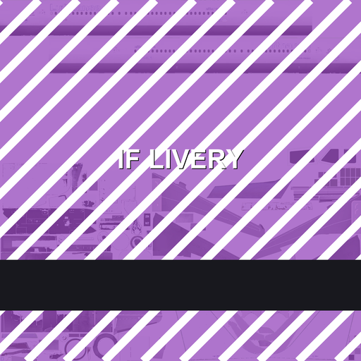

# Infinite Flight Livery Pipeline

**Repaint any aircraft in Infinite Flight without root, without a jailbreak, and without touching the APK.**

English · [日本語](README.ja.md) · [繁體中文](README.zh-Hant.md)



---

## A preface, in which I stop being polite

I paid. That means I am not allowed to ask when anything ships. A delay is not a delay, it is
"soon™", and pointing that out makes you the unreasonable one. Fine. Round of applause for the
business model.

And the defence squad — my god. The forums, the socials, the streaming platforms, all of them
manned. Somebody is being paid to sit there and explain that everything is fine. I genuinely want to
know what the PR budget looks like, because it has to be Huawei-on-the-mainland money. LMAO.

IFATC recruitment standards slide further every cycle. Nobody shows up to the Officer radar course.
Promotion runs on who you know. Laura is busy monetising. Virtual airlines are consumables; Live is
the favoured child. IFAET hiring and training is an unfathomable mystery — you get in, and then
nobody trains you, they just hand you a training manual from the previous century and point at an
editor from the previous century. Go on then. Operate it.

While you are in there: airport easter eggs are off limits, houses are not allowed slanted roofs. Ah,
I do love a good tin box. More perfectly square airports, please, that's the stuff. And yes, they did
ship a new editor — the UI of which tells me everything I need to know about how much AI-assisted
coding went into this team. AI-sugoi. Some of those panels are so jarring that even after the
polish pass they still look like a stranger walked into the room.

Meanwhile, community members who strut around playing spy, dunking on each other and radiating
arrogance are perfectly fine — as long as the money keeps flowing. Nothing to see. Move along.

And liveries? *You* think *you* get to make demands? We do what we want. The vendor is the boss here.

Voting? That is the same comedy as the mainland's rubber-stamp congress. Looks like democracy,
functions as decoration. And if you dare ask in the community when liveries are coming — release the
shills! Defend the castle! Defend the castle!

The part I genuinely cannot get over: a staff member separating Tibet from the mainland when
speaking. Imagine that being your customer-facing voice. That is not an editorial slip, that is
prejudice with a microphone. You do not want to make liveries? Then don't. You have a bias against
the mainland? Keep it, it's yours. North Korea blocks your storefront too — go shout at Kim Jong Un
instead, see how that goes. XSWL.

That is all I can dredge up off the top of my head. Fix the community and fix the product, or this is
where it ends.

---

## What this repository is

A complete, reproducible map of **every aircraft in the sim** and exactly what a repaint has to write
for each one, measured from the official package catalog rather than guessed:

| | |
|---|---|
| Aircraft documented | **65** — one page each, see [docs/models/index.md](docs/models/index.md) |
| Named liveries catalogued | **1,260** |
| Model packages parsed | **65** (681 MB) — glTF mined for every `images[].uri` |
| Official livery packages parsed | **65** (233 MB) — the files a repaint actually replaces |
| Local device condition | no root, locked bootloader, Android 16; iOS without jailbreak |

For each aircraft you get: the repository name, the model package and its glTF files, every baseColor
texture the model references, the exact files an official livery ships (with dimensions), the on-disk
directory name for every livery (which is *not* the name shown in the app), and a ready-to-run
packaging command.

Start here: **[docs/models/index.md](docs/models/index.md)**.

---

## The five steps

```
① locate  ──►  ② paint  ──►  ③ package  ──►  ④ import  ──►  ⑤ drop the cache
   repo / dir /     same size,     Zip Slip        Scenery        pm trim-caches
   file names       WebP            entry names     Import Imagery  (or iOS clear cache)
```

### ① Locate the three identifiers

```
/data/user/0/com.fds.infiniteflight/files/aircraft/<repo>/liveries/<directory>/<file>.webp
                                                      └ aircraft  └ livery dir  └ texture
```

- **repo** — `RepositoryName.ToLowerInvariant()`, e.g. `infiniteflight-aircraft-a320`
- **directory** — `Path.GetFileName(LiveryPackage.Path)`. The folder is frequently *not* the name the
  app displays; every aircraft page lists its own mapping
- **file** — fixed by the model's glTF; `Texture.webp` ≠ `texture.webp`

### ② Paint

Same dimensions as the original, WebP q90–95. Legacy single-texture aircraft need three files or the
fuselage renders as black chrome:

| file | channel | value |
|---|---|---|
| `Texture.webp` | baseColor | your artwork |
| `Texture_ORM.webp` | R=AO / G=roughness / B=metallic | solid `(255,200,0)` |
| `Texture_N.webp` | normal | solid `(128,128,255)` |

Modern aircraft instead carry one `<Part>_albd.webp` per body part — the exact list per aircraft is
in its page under `docs/models/`.

### ③ Package

```bash
python tools/build_slip_package.py \
  --platform android \
  --aircraft-repo infiniteflight-aircraft-a320 \
  --livery-dir "<livery directory>" \
  --texture "Texture.webp=art/a320.png" \
  --fill-orm --fill-normal \
  --out out/a320.zip
```

Entry names come out as the write targets:

```
../../files/aircraft/infiniteflight-aircraft-a320/liveries/<livery directory>/Texture.webp
```

`--dry-run` prints them without writing a file. The two leading `../` are mandatory: one level up
from the extraction folder still leaves you inside the cache.

### ④ Import

1. Open the app → **Scenery Editor**
2. **Open an airport** — skip this and the import is silently discarded
3. **Satellite → Import Imagery** → pick the zip
4. Wait a couple of seconds (no progress bar, no success message)
5. Force-stop the app and reopen

### ⑤ Drop the texture cache

```bash
adb shell "pm trim-caches <bytes>"
```

Pass a value larger than the tile cache and it clears to that free-space target. Needed only when
repainting *the same livery directory* again. On iOS: Settings → General → Clear Cache, then swipe
the app away.

---

## Repository layout

```
README.md                  this file (English) · ja / zh-Hant translations alongside
docs/
  preface.md             the preface, in three languages
  mechanism.md           why a zip can write into the app sandbox (with the decompiled code)
  paths-and-textures.md  path rules, pipelines, name mismatches
  build-and-import.md    packaging and importing in full detail
  ios.md                 iOS container root, transport, cache
  troubleshooting.md     black chrome, one-shot repaints, silent failures, dead ends
  data-provenance.md     how the 65 aircraft pages were generated
  models/index.md        all 65 aircraft with file counts
  models/<aircraft>.md   one page per aircraft
tools/
  build_slip_package.py    textures → importable zip (the core tool)
  probe_matrix.py          two-round colour/number probes for unknown paths or files
  livery_tool.py           compose, inspect, archive
  fetch_catalog.py         the package catalog (guest JWT + signed download URLs)
  extract_models.py        mine glTF for texture references per aircraft
  extract_liveries.py      inventory an official package class per aircraft
  build_docs.py            render docs/models/* from data/
  selftest.py              offline checks, also run by CI
data/                      catalog snapshot + generated inventories (see provenance doc)
examples/a320-demo/        a ready-to-import example package
```

## Verify it yourself

```bash
pip install -r tools/requirements.txt
python tools/selftest.py
```

CI runs the same script: entry-name assertions, the iOS root, documentation links, per-aircraft page
coverage, and the example package structure.

## Asset downloads

The tools work from file names and dimensions, so none of this is required to repaint anything.
Everything too large or too original to sit in git is published as a release attachment instead:

| archive | contents | size |
|---|---|---|
| `livery-templates.zip` | painted templates, UV layout sheets, blank canvases, grid overlays, reference renders | ~741 MB |
| `official-templates.zip` | official blank template exports per aircraft (PNG + WEBP) | ~142 MB |
| `sample-packages.zip` | official model and livery packages kept for reference | ~451 MB |
| `manifests.zip` | package manifests kept from the catalog | ~5 MB |

→ **[assets-2026-11 release](https://github.com/kitalikesfreedom/infinite-flight-livery-pipeline/releases/tag/assets-2026-11)**

## Contributing

I know this route will be closed sooner or later — one validation check on the client side and the
door is shut. So: if you care about custom liveries, you are welcome to help maintain this project.
Corrections, new aircraft, better tooling, cleaner documentation — all of it counts. Genuinely
grateful for any of it.

Cannot make sense of any of this? Let CODEX do the work for you.

## Credits

| role | who |
|---|---|
| First author | ChatGPT 6 Astra & 6.1 Sol |
| Second author | DeepSeek V4.1 Flash |
| Assistance | kita, some IFATC and IFAET members, and friends |
| Maintainer | YG |

For the safety of their accounts and their lives, thanks are recorded here and nowhere else.

MIT · data snapshot dated 2026-11-09
