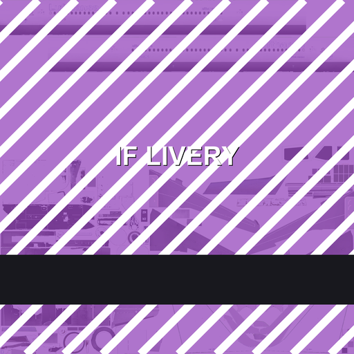

# Infinite Flight 塗裝管線

**不需要 root、不需要越獄、不必改 APK，就能重繪 Infinite Flight 的機身塗裝。**

[English](README.md) · [日本語](README.ja.md) · 繁體中文



---

## 前言 —— 我不打算再客氣了

錢我付了。所以「什麼時候出」是不能問的。延期也不算延期，叫「soon™」；你指出來，反而變成不講理
的那個人。好啊，這套生意經，拍手。

還有護航大隊。論壇、社群、串流平台，全都有人守著。有人領錢坐在那裡解釋「一切都很好」。
我真的很好奇公關預算長什麼樣子，肯定是大陸華為那個等級。笑死。

IFATC 的招募標準一輪比一輪低。Officer 雷達課沒人要去上。升遷看關係。Laura 忙著變現。
VA 是消耗品，Live 才是親兒子。IFAET 的招募跟培訓根本是玄學 —— 進去了也沒人帶你，丟一本上個
世紀的訓練手冊給你，再指著一個上個世紀的編輯器說：去操作啊。

順便講，機場彩蛋不准用，房子不准做斜屋頂。啊，我就是愛這種鐵盒子，正方形機場多來幾座，好耶。
對了，他們真的出了新編輯器 —— 看那個 UI 就知道這團隊塞了多少 AI 輔助寫程式。AI 賽高。有些面板
突兀到不行，就算優化過了，還是像有個外人站在房間裡。

至於社群裡那些搞拉踩、玩間諜、高傲到不行的人？沒事，只要不影響老子賺錢就好。當作沒看到。

塗裝？你們也配提要求？我們想做什麼就做什麼。**乙方才是大爺。**

投票？那跟大陸的人大代表一個可笑性質，看起來很民主，功能是裝飾。你敢在社群問一句「塗裝呢」——
護航大隊出動！護駕！護駕！

我最過不去的還是這件：有工作人員講話時把西藏跟大陸分開講。這是對外窗口該說的話嗎？那不叫口誤，
那叫拿著麥克風的偏見。你不想做塗裝，那就不要做；你對大陸有偏見，那是你的，留著。北韓也不讓你
上架啊 —— 去噴金正恩看看會怎樣。笑死。

一時半刻也就想到這些。社群跟內容不好好整改，這遊戲大概就這樣了。

---

## 這個儲存庫是什麼

一份**遊戲內全部 65 種機型**的完整、可複現對照：每一型重繪時究竟要寫入哪些檔案，而且是從官方
套件目錄量出來的，不是猜的。

| | |
|---|---|
| 收錄機型 | **65** —— 每型一頁，見 [docs/models/index.md](docs/models/index.md) |
| 收錄塗裝 | **1,260** |
| 解析的模型套件 | **65**（681 MB）—— 掃過每個 glTF 的 `images[].uri` |
| 解析的官方塗裝套件 | **65**（233 MB）—— 真正會被替換的檔案 |
| 驗證環境 | 無 root、BL 上鎖、Android 16；iOS 無越獄 |

每一型都能查到：repository 名稱、模型套件與 glTF、模型引用的所有 baseColor、官方塗裝實際帶的
檔案（含實際尺寸）、**與 App 顯示名稱不同的**磁碟目錄名，以及可直接執行的打包指令。

從這裡開始 → **[docs/models/index.md](docs/models/index.md)**

---

## 五個步驟

```
① 定位  ──►  ② 繪製  ──►  ③ 打包  ──►  ④ 匯入  ──►  ⑤ 丟掉快取
   repo / 目錄 /   相同尺寸的    Zip Slip      Scenery       pm trim-caches
   檔名            WebP          條目名稱      Import Imagery （iOS 用 App 內清除）
```

### ① 定位三個識別字

```
/data/user/0/com.fds.infiniteflight/files/aircraft/<repo>/liveries/<directory>/<file>.webp
```

- **repo** — `RepositoryName.ToLowerInvariant()`，例如 `infiniteflight-aircraft-a320`
- **目錄** — `Path.GetFileName(LiveryPackage.Path)`。資料夾名稱經常跟 App 顯示的不一樣，
  每一型都有自己的對照表
- **檔名** — 由 glTF 釘死。`Texture.webp` 與 `texture.webp` 是兩回事

### ② 繪製

與原圖完全同尺寸，WebP q90–95。舊式單張機型必須三張一起換，否則機身會變成黑色鏡面：

| 檔案 | 通道 | 建議值 |
|---|---|---|
| `Texture.webp` | baseColor | 你的圖 |
| `Texture_ORM.webp` | R=AO / G=粗糙度 / B=金屬度 | 單色 `(255,200,0)` |
| `Texture_N.webp` | 法線 | 單色 `(128,128,255)` |

新式機型則是每個部位一張 `<Part>_albd.webp`，各機型的完整清單在其頁面。

### ③ 打包

```bash
python tools/build_slip_package.py \
  --platform android \
  --aircraft-repo infiniteflight-aircraft-a320 \
  --livery-dir "<塗裝目錄>" \
  --texture "Texture.webp=art/a320.png" \
  --fill-orm --fill-normal \
  --out out/a320.zip
```

條目名稱就是寫入目標：

```
../../files/aircraft/infiniteflight-aircraft-a320/liveries/<livery directory>/Texture.webp
```

開頭的兩個 `../` 不可省：從解壓資料夾只退一層，還留在快取目錄裡。
`--dry-run` 可先看條目名稱而不落地。

### ④ 匯入

1. 開 App → **Scenery Editor**
2. **先打開一個機場** ← 少了這步，匯入會被默默丟棄
3. **Satellite → Import Imagery** → 選 zip
4. 等幾秒（沒有進度條，成功也沒有提示）
5. 完全關閉 App（從最近任務移除）再開

### ⑤ 丟掉貼圖快取

```bash
adb shell "pm trim-caches <bytes>"
```

填一個大於貼圖快取的值，就會清到那個可用空間目標。只有重繪**同一個塗裝目錄**時才需要。
iOS 則是 設定 → 一般 → 清除快取，再上滑關閉 App。

---

## 目錄結構

```
README.md / README.ja.md / README.zh-Hant.md
docs/
  preface.md            前言（三種語言）
  mechanism.md          為什麼 zip 能寫進沙盒（附反編譯程式碼）
  paths-and-textures.md 路徑規則、兩代著色管線、命名陷阱
  build-and-import.md   打包與匯入的完整細節
  ios.md                iOS 容器根、傳輸方式、快取
  troubleshooting.md    變黑／只能改一次／無聲失敗／已排除的死路
  data-provenance.md    65 個機型頁面是怎麼生成的
  models/               全 65 型（索引 + 各機型頁）
tools/                     打包、探測、目錄取得、抽取、生成、自檢
data/                      目錄快照與生成後的清冊
examples/a320-demo/        可直接匯入的範例
```

## 自己驗一次

```bash
pip install -r tools/requirements.txt
python tools/selftest.py
```

CI 跑的是同一支腳本：條目名稱斷言、iOS 根路徑、文件連結、機型頁面覆蓋率、範例套件結構。

維護：YG · MIT · 資料快照 2026-11-09
