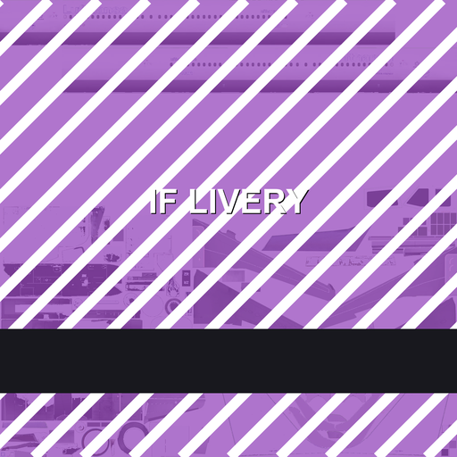

# Example · an A320 in stripes

A complete, importable package you can use to prove the chain end to end: the import succeeds, the
files land, and you can watch a directory appear under the app's livery tree.



| file | what it is |
|---|---|
| `a320-demo.zip` | the importable archive — 3 entries, 227 KB |
| `texture-source.png` | the 2048×2048 source: the official blank template with a purple wash, white diagonals and a caption |
| `preview.png` | thumbnail |

## Entries in the archive

```
../../files/aircraft/infiniteflight-aircraft-a320/liveries/<livery directory>/Texture.webp
../../files/aircraft/infiniteflight-aircraft-a320/liveries/<livery directory>/Texture_ORM.webp
../../files/aircraft/infiniteflight-aircraft-a320/liveries/<livery directory>/Texture_N.webp
```

`Texture_ORM` and `Texture_N` are solid fills — `(255,200,0)` and `(128,128,255)` — that exist purely
to stop the fuselage from rendering as black chrome.

## Use it

```bash
adb push a320-demo.zip /sdcard/Download/a320-demo.zip
# in the app: Scenery Editor → open an airport → Satellite → Import Imagery → pick it
adb shell "pm trim-caches <bytes>"
# force-stop the app, reopen
```

> **This archive writes into a placeholder directory**, so it proves the mechanism but changes no
> airframe you can fly. To see paint on a fuselage, rebuild with a real directory from
> [the A320 page](../../docs/models/a320.md) — it lists every livery directory for the type — and
> keep the file names identical to the ones on that page.

## How it was made

```bash
# 1) draw on the official blank template (the result is committed: texture-source.png)
# 2) package
python tools/build_slip_package.py \
  --platform android \
  --aircraft-repo infiniteflight-aircraft-a320 \
  --livery-dir "<livery directory>" \
  --texture "Texture.webp=examples/a320-demo/texture-source.png" \
  --fill-orm --fill-normal \
  --out examples/a320-demo/a320-demo.zip
```

The fastest way to test a colour is a flat probe:

```bash
python tools/build_slip_package.py --platform android \
  --aircraft-repo infiniteflight-aircraft-a320 --livery-dir "<livery directory>" \
  --tint A014BE --texture Texture.webp --fill-orm --fill-normal \
  --out out/tint.zip
```
